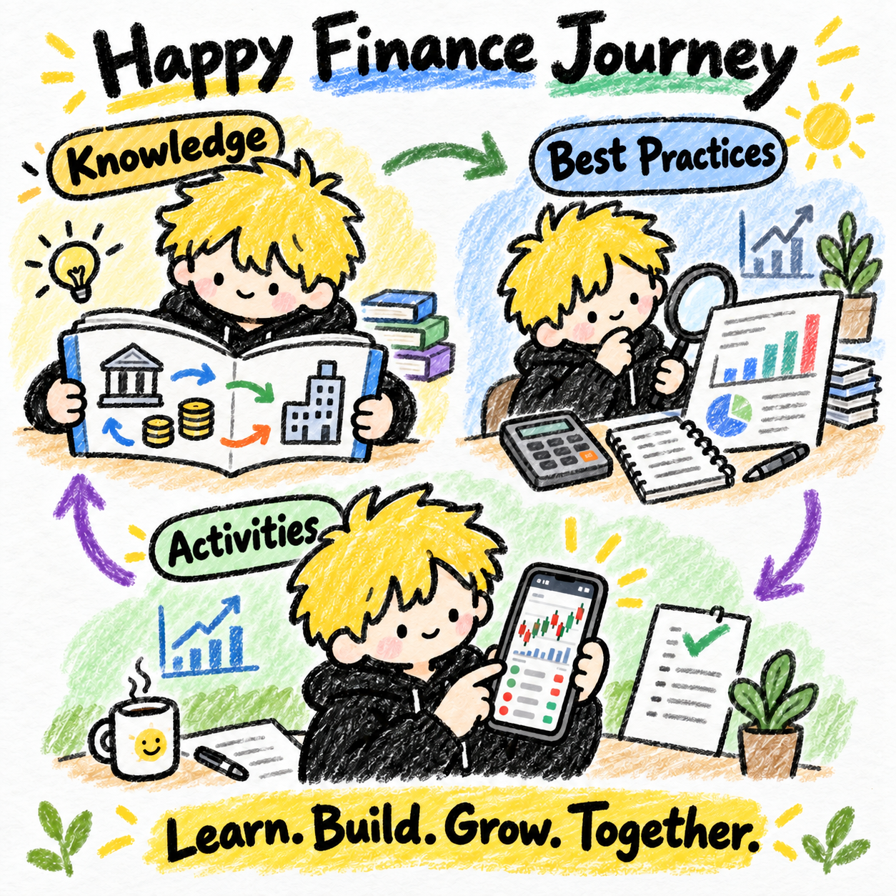

**English** | [简体中文](GUIDE.zh-CN.md)



- [Knowledge](knowledge/README.md): Understand financial concepts, mechanisms and their scope.
- [Best Practices](practices/README.md): Develop evidence-based research and decision methods that can be reviewed.
- [Activities](activities/README.md): Learn, practice, verify and reflect through concrete questions.

[Visit the website](https://happy-finance.anjing.cc) · [GitHub Pages fallback](https://anjing-le.github.io/happy-finance-journey/overview.html)

Linked learning articles and the website currently remain primarily in Chinese. A bilingual README does not imply that every lesson or illustration has been translated.

<a id="目标"></a>
## Goal

Happy Finance Journey records my long-term financial learning and practice, with stock investing and trading as the eventual practical direction. It gradually organizes worthwhile questions, personally tested methods and participatory activities so readers can read, check and practice without first learning the repository structure or using a particular AI tool.

Current work focuses on knowledge and practices; activities are paused. The learning scope retains the existing two tracks and twelve chapters. Add topics when needed, and do not present unverified views as conclusions.

## Maintenance rules

- **Getting started**: Read this page and the target module README; for activities, read the [shared principles](activities/DESIGN.md). Repository files support continuity.
- **Organization**: One Markdown source per item, connected with relative links. Keep the three modules flat initially; subdivide when sufficient content and a clear use justify it.
- **Original writing**: Write our own articles, without external-reference, repost or original-source entry sections in the website body. Existing titles form a refinement backlog.
- **Accuracy and timeliness**: Verify the relevant date, region and conditions for facts, data, markets, policies and rules. Separate confirmed facts, inferences, personal opinions and open questions.
- **Best practices**: Explain the problem, method, applicable conditions, evidence and limits. Personal experience is not automatically a general rule; drafts are not verified practices.
- **Activities**: Set goals, process and checkable outputs around a concrete question. Link knowledge and practices rather than duplicating them.
- **Public boundaries**: Do not publish private accounts, trade records, credentials or unauthorized material. Use verifiable case data and distinguish examples from actual records.
- **Iteration**: Question → research and practice → record results → review and revise. After Markdown edits, check links, run `npm run build`, then publish. The website is built from source content; do not separately maintain its body.

<a id="待办"></a>
## Backlog

The framework exists. All twelve chapters in the [learning outline](knowledge/README.md) have illustrated learning drafts. Their explanations still need item-by-item learning and feedback; specific methods have not been validated through live trading. Knowledge and practices remain the focus; activities are paused.

- [x] Complete text drafts for the existing twelve chapters.
- [x] Retain Chapter 1's thirteen images and add illustrations for the 104 knowledge points in Chapters 2–12.
- [ ] Starting with Chapter 2, Candlesticks and Market Structure, learn each point together and revise explanations.
- [ ] Update text, images and the Anjing finance Skill from learning feedback.
- [ ] Choose the first real financial question, necessary knowledge and verification method.
- [ ] Select one personally tried method and document evidence, conditions and limits.
- [ ] Keep activities paused; when resumed, define the first activity's goals, prerequisites and checkable outputs.

## Frontend

Content and presentation live separately within the same repository:

- `knowledge/`, `practices/`, `activities/`: Markdown, the sole article sources.
- `src/`: React and TypeScript components and styles.
- `scripts/content.mjs`: Reads Markdown, generates chapter/article data, checks local document links and sanitizes HTML.
- `scripts/prerender.mjs`: Prerenders full HTML into `dist/`; the client handles reading dialogs and mobile tabs.
- `assets/`: Original public assets, copied to the website during builds.

### Local development

Requires Node.js 22.12+.

```sh
npm ci
npm run dev
npm run build
npm run preview
```

After Markdown changes in development, run `npm run content` to refresh content. Do not commit generated data or build output. Add knowledge and practice articles as Markdown in their existing directories; the website lists them automatically. Continue linking chapters in module READMEs. Do not hand-edit HTML or JSON.

### Publishing

- Cloudflare Pages project: `happy-finance-journey`; domain: `happy-finance.anjing.cc`.
- Build command: `npm run build`; output: `dist`; Node.js: 22.
- Updates to GitHub `main` trigger Cloudflare builds; the deployment hook is stored in repository secret `CF_PAGES_DEPLOY_HOOK`.
- GitHub Pages builds through Actions using `BASE_PATH=/happy-finance-journey/`.
- The same frontend generates `overview.html` for old bookmarks.

Continue by maintaining the engineering and framework, refining articles individually, then improving from real usage feedback.

The site uses three columns: Knowledge, Best Practices and Activities. Its homepage omits a large brand title, poster and promotional copy. Knowledge-track tags appear beside chapter titles; chapters remain peer-level cards opening reading dialogs. Mobile shows one full column at a time, switched by horizontal swipe or top tabs. Tabs stay visible without scrolling the page when clicked. Homepage and dialogs reserve iPhone safe-area space.

### Engineering checks before content iteration

- Cards and dialogs share module colors: knowledge blue, practices green, activities orange. Dialogs omit a duplicate title bar, preserve Markdown titles and use dark body text for readability.
- Mobile columns support deep links and restoration on back navigation. Newly opened content starts at the top; close buttons and Esc are supported.
- Parse, sanitize and prerender article bodies at build time, without a browser Markdown parser. Lazy-load article images; embed real PNG/WebP dimensions during builds to reserve space and avoid shifting anchor targets. New knowledge images use lossless WebP; preserve original generated drafts.
- Keep flat Markdown and automatic publishing for now. Evaluate search, pagination and lazy article loading when content grows; do not preemptively add directory layers.

The twelve knowledge chapters contain 117 illustrated learning-draft sections, explaining one point at a time with short statements of meaning, use and necessary limits. Chapter 1, Basic Terms, retains its thirteen illustrated sections; the stock example was approved. The 104 points in Chapters 2–12 have landscape images under the user's latest authorization. Image regions correspond to identically named text items in the same order, using a white background, Anjing IP and crayon style. Next, learn point by point and revise articles, images and the finance Skill from feedback. A draft is not evidence of mastery, approval of every item or live-trading validation. Best Practices retains thirteen existing titles for gradual writing; activities remain paused.

Articles use a narrow table of contents beside complete Markdown. The first source is `knowledge/basic-terms.md`, with thirteen terms as peer `##` headings. Generate navigation from article headings; selecting an entry scrolls only the article, while manual scrolling updates the current entry without hiding other sections. Dialogs and standalone article URLs share the component. On desktop, text and images fill the available right-side width. Hide article scrollbars; a rounded, lightly colored current-entry background fills left to right to show section position, using the module color. Support natural scrolling plus arrow keys, PageUp/PageDown and Home/End when focused. Recalculate positions after images load or the window changes size.

Chapter READMEs link to standalone articles through “Read full article”; homepage chapter cards open the article directly rather than duplicating cards. Edit only Markdown bodies; navigation updates automatically. Insert relative-path images and display them in full. Copy Markdown to migrate text; when local images are included, carry them along and preserve relative paths. Basic Terms orders stocks, share price, shares outstanding, market capitalization, percentage change, price amplitude, trading volume, turnover value, turnover rate, bulls, bears, long positions and short positions. Each section uses bullet items matching the names and order in its diagram. All numbers are teaching assumptions; add later terms at the same heading level in a suitable learning order.

New knowledge points may begin with a plain Markdown illustration placeholder, replaced by a relative image path when ready. Version revised illustrations and retain previous drafts; carry referenced images when migrating illustrated content.
